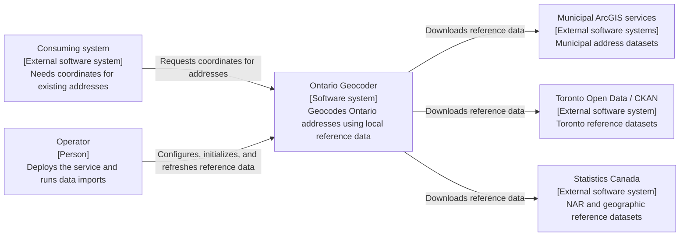
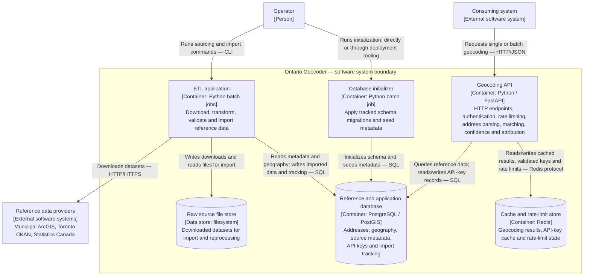
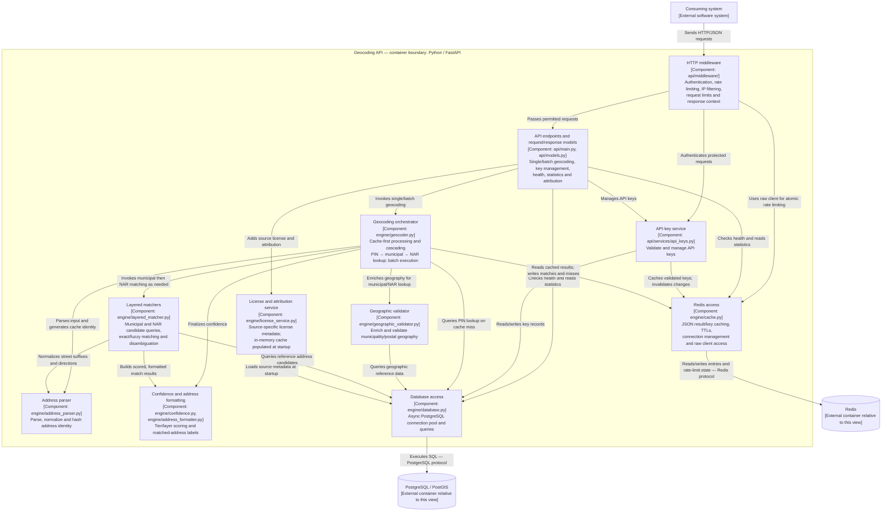

# Ontario Geocoder — C4 review diagrams

These diagrams describe the current implementation, not a proposed service split.
They use Mermaid flowcharts with explicit C4 boundaries and element types.
Arrows describe calls/dependencies; responses return over the same relationship
unless stated otherwise. External data providers remain outside the system boundary.

## Level 1 — System context

- The consumer receives geocoding results and is responsible for updating its own records.
- The geocoder pulls source data; providers do not push updates into it.
- Provider boxes group representative integrations, rather than enumerate every source.

## Level 2 — Containers

### Container interpretation

- **The matching engine is part of the API container.** It is not a separate service or network hop.
- ETL is an explicitly invoked batch application, not an always-running ingestion service. No automatic refresh schedule is implied.
- Raw files are stored under `data_sourcing/data_sources/`; production Compose bind-mounts this directory into ETL.
- ETL writes the database; the API does not read raw source files or query providers during geocoding.
- The initializer is shown for completeness. It is a one-shot deployment application, separate from reference-data imports.
- A C4 container is an application or data store, not necessarily a Docker container. These logical boundaries also apply to the non-Docker VM deployment.

## Level 3 — Geocoding API components

Scope: expands **only the Geocoding API container** from Level 2. ETL and the database initializer are not components of this container.

### Runtime behaviour

1. Middleware applies request controls and authenticates protected requests.
2. A geocoding endpoint calls the orchestrator in the same process.
3. The orchestrator parses the address and checks Redis before any matching tier.
4. On a cache miss, it tries PIN lookup, municipal matching, then NAR matching against PostgreSQL.
5. Successful results are cached (default 24 hours); not-found results are negatively cached (default 1 hour).
6. The endpoint adds response context and source attribution, then returns the result. Batch geocoding reuses the same orchestrator.

Component arrows are dependencies, not a strict sequence diagram. In particular,
PIN lookup bypasses the layered matchers, and a geocoding cache hit bypasses all
matching tiers. Geographic and license in-memory caches are not Redis caches.

## Implementation anchors

| Architectural element | Implementation |
|---|---|
| API and matching engine share one deployable application | `Dockerfile`; `api/main.py` imports and calls `engine.geocoder` |
| API, database, Redis, ETL and initializer runtime definitions | `docker-compose.prod.yml` |
| ETL entry points and source workflows | `data_sourcing/setup_data.py`, `data_sourcing/downloaders/`, `data_sourcing/importers/` |
| ETL transformation and validation | `data_sourcing/transformers/`, `data_sourcing/validators/` and importer-level validation |
| Raw file store mount | ETL volume in `docker-compose.prod.yml` |
| Database initialization | `database/run_migrations.py` |
| Cache-first geocoding and cascading tiers | `engine/geocoder.py` |
| Redis caching and TTL defaults | `engine/cache.py` |
| Authentication caching and rate limiting | `api/services/api_keys.py`, `api/middleware/rate_limiter.py` |
